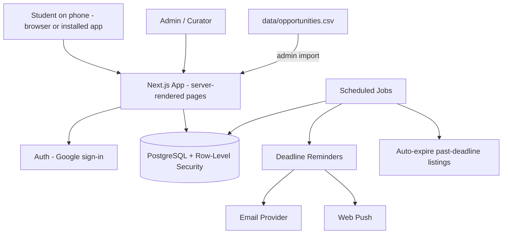

# System Design 1/5 — Purpose, Architecture & Tech Stack

> Part of [system-design](../system-design.md) · [Next](02-core-modules.md) →

## ✅ What to do with this file

- [ ] Agree on the modular-monolith architecture (no microservices).
- [ ] Confirm the stack below, or record a different choice as a decision.
- [ ] Use free tiers during the pilot; set a monthly budget cap.
- [ ] Record each choice as an architecture decision (see [Part 5 §13](05-security-ops-testing-phases.md#13-architecture-decisions-to-record)).

---

## 1. Purpose

This is a practical, incremental architecture for the Student Opportunity Hub: a free, phone-first platform where students **find, share, save, and get reminded about** verified opportunities. Nothing is built yet.

The MVP prioritizes:
- fast public listing pages that work well when shared in Messenger/FB
- trustworthy, curated listings with automatic expiry
- save + reminders (email and push)
- privacy and low running costs

**Not in scope:** payments, student-facing AI, social-media scraping, document uploads. Compliance tools (OJT checklist) arrive in Phase 2; the DOST ROS tracker is deferred.

## 2. Architecture Overview

A **modular monolith**: one Next.js app with one PostgreSQL database, scheduled jobs, an email provider, and web push.

### How listings get in
1. **Human curation:** curators research official sources and enter listings in the admin panel or the spreadsheet.
2. **Spreadsheet import:** the admin panel imports `data/opportunities.csv`.
3. **Later:** official RSS feeds, organizer submissions, AI-assisted entry.

No scraping of Facebook, LinkedIn, or other platforms.

## 3. Technology Stack

| Layer | Choice | Why |
|---|---|---|
| Frontend + backend | **Next.js (TypeScript)** | Server-rendered pages load fast on slow connections and give good link previews; one codebase |
| Hosting | Vercel | Managed, free tier for the pilot |
| Database | Managed **PostgreSQL** (Supabase) | Free tier, Row-Level Security, built-in auth |
| Auth | **Supabase Auth with Google sign-in** | Fastest sign-up for students; no passwords to manage |
| Scheduled jobs | Vercel Cron or Supabase scheduled functions (Inngest/Trigger.dev if needed) | Reminders and auto-expiry |
| Email | Resend | Reminder emails |
| Push notifications | Web Push (VAPID) via a service worker | Phone notifications without a native app |
| Installable app | Web app manifest + service worker | "Add to home screen" |
| Analytics | Privacy-friendly product analytics (e.g., PostHog or Plausible) | Measure the feature signals in the idea doc |
| Monitoring | Error tracking + uptime checks | Catch problems early |

Use **one** backend: Next.js server routes/server actions.

### Estimated monthly cost (pilot)

| Item | Estimate |
|---|---|
| Hosting + database + auth | $0 on free tiers; ~$25–50 once you outgrow them |
| Email | $0–20 |
| Analytics + monitoring | $0 on free tiers |
| Domain | ~$10–15 per year |
| **Total** | **About $0–75/month** during the pilot |

Check current provider pricing; free-tier limits change.
