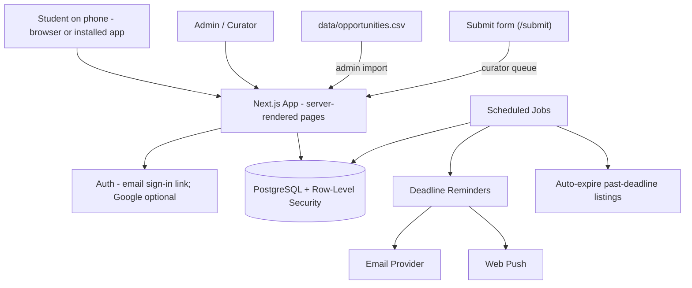

# System Design 1/5 — Purpose, Architecture & Tech Stack

> Part of [system-design](../system-design.md) · [Next](02-core-modules.md) →

## ✅ What to do with this file

- [ ] Agree on the modular-monolith architecture (no microservices).
- [ ] Confirm the stack below, or record a different choice as a decision.
- [ ] Use free tiers during the pilot (the free `*.vercel.app` address is fine for the sprint); set a monthly budget cap.
- [ ] Build nothing marked *planned* until the 30-day sprint passes ([final decisions §1c](../research/final-decisions.md#1c-updates-after-the-court-review-2026-10-26)).
- [ ] Record each choice as an architecture decision (see [Part 5 §13](05-security-ops-testing-phases.md#13-architecture-decisions-to-record)).

---

## 1. Purpose

This is a practical, incremental architecture for the Student Opportunity Hub: a free, phone-first platform where students **find, share, save, and get reminded about** checked opportunities. "Checked" means *a person opened the source and confirmed the details on the date shown*. The MVP is built but not deployed yet; [Part 5 §11](05-security-ops-testing-phases.md#11-build-phases) shows what's built and what's planned.

The MVP prioritizes:
- fast public listing pages that work well when shared in Messenger/FB
- trustworthy, curated listings with automatic expiry
- save + reminders (email and push)
- privacy and low running costs

**Not in scope:** payments. Phase 2 work built on 2026-10-25 (audience filters, add to calendar, `/submit` + curator queue, OJT checklist) stays as it is. **Planned, frozen until the sprint passes:** document uploads, the AI helper, the Android/iPhone app, and the rest of the curator inbox ("Share to Oportune", connected pages). The DOST ROS tracker is deferred.

## 2. Architecture Overview

A **modular monolith**: one Next.js app with one PostgreSQL database, scheduled jobs, an email provider, and web push. The diagram shows what's built. File storage, an AI provider, the mobile app, and the full curator inbox are planned (frozen) and would live in the same app and database.

### How listings get in
1. **Human curation:** curators research sources (the organizer's own page first) and enter listings in the admin panel or the spreadsheet.
2. **Spreadsheet import:** the admin panel (or `npm run import:opportunities`) imports `data/opportunities.csv` as drafts.
3. **"Submit an opportunity" form** (`/submit`, built 2026-10-25): signed-in students and organizers send a link; it lands in the curator queue at `/admin/submissions`. Nothing is published without a curator.
4. **Planned, frozen until the sprint passes:** a fuller curator inbox fed by "Share to Oportune" (the phone's share menu), paste-to-draft for curators, and connected pages (page admins connect through the official API). Later still: official RSS feeds, AI-assisted entry (assists curators, never decides), Facebook Page Public Content Access.

No scraping of Facebook, LinkedIn, or other platforms, and no AI in the app today.

## 3. Technology Stack

| Layer | Choice | Why |
|---|---|---|
| Frontend + backend | **Next.js (TypeScript)** | Server-rendered pages load fast on slow connections and give good link previews; one codebase |
| Hosting | Vercel | Managed, free tier for the pilot |
| Database | Managed **PostgreSQL** (Supabase) | Free tier, Row-Level Security, built-in auth |
| Auth | **Supabase Auth**: one-time email sign-in link; Google sign-in is wired and its button shows once the provider is switched on in Supabase (not configured yet) | No passwords to manage |
| Scheduled jobs | **Vercel Cron** (`vercel.json`) calling `/api/jobs/*` | Reminders, auto-expiry, cleanup; a run stops before the function time limit and the next run resumes |
| Rate limiting | Postgres `rate_limits` table (`hit_rate_limit()` function); Cloudflare Turnstile captcha on the report and submit forms. The Upstash variables in `.env.example` aren't used by the code | Serverless functions don't share memory |
| Search | Postgres full-text (`simple` config) + `pg_trgm` | Works with Taglish and typos; no extra service |
| Email | Resend | Reminder emails |
| Push notifications | Web Push (VAPID) via a service worker | Phone notifications without a native app |
| Installable app | Web app manifest + service worker | "Add to home screen" |
| File storage (planned, frozen) | Supabase Storage, private bucket | Same access rules as the database; owner-only |
| AI helper (planned, frozen) | An LLM API (e.g., Claude) called only from the server | Key never reaches the browser; per-student daily limits |
| Mobile app (planned, frozen) | Capacitor wrapper around the web app | One codebase; Google Play first, then App Store |
| Analytics | Our own `analytics_events` table, read in Admin → Stats (no third-party tool) | Measure the feature signals in the idea doc; no extra service |
| Monitoring | Vercel logs for now (no error-tracking service wired yet) + uptime checks | Catch problems early |

Use **one** backend: Next.js server routes/server actions.

### Estimated monthly cost (pilot)

| Item | Estimate |
|---|---|
| Hosting + database + auth | $0 on free tiers; ~$25–50 once you outgrow them |
| Email | $0–20 |
| Analytics + monitoring | $0 on free tiers |
| Domain | ~$10–15 per year; not needed for the sprint (the free `*.vercel.app` address is fine) |
| AI helper + file storage (planned, frozen) | Depends on usage; set a hard monthly cap with the provider |
| App store accounts (planned, frozen) | One-time Google Play fee; yearly Apple fee (check current prices) |
| **Total** | **About $0–75/month** during the pilot |

Check current provider pricing; free-tier limits change. Known limits to plan around (Vercel Hobby is non-commercial, Supabase Free pauses inactive projects, email free tiers cap daily sends) are in [Deployment Part 4 §10](../deployment/04-domain-jobs-and-push.md#10-scheduled-jobs).
