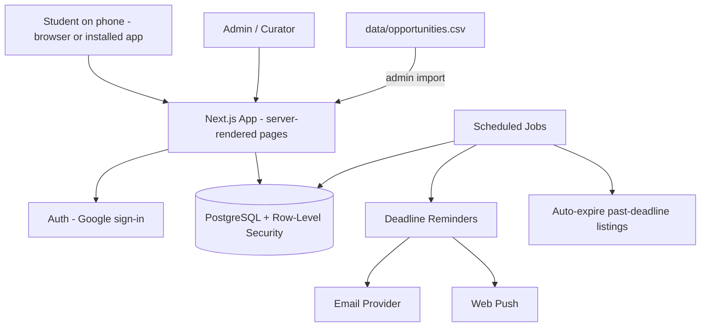

# System Design 1/5 — Purpose, Architecture & Tech Stack

> Part of [system-design](../system-design.md) · [Next](02-core-modules.md) →

## ✅ What to do with this file

- [ ] Agree on the modular-monolith architecture (no microservices).
- [ ] Confirm the stack below, or record a different choice as a decision.
- [ ] Use free tiers during the pilot; set a monthly budget cap.
- [ ] Record each choice as an architecture decision (see [Part 5 §13](05-security-ops-testing-phases.md#13-architecture-decisions-to-record)).

---

## 1. Purpose

This is a practical, incremental architecture for the Student Opportunity Hub: a free, phone-first platform where students **find, share, save, and get reminded about** verified opportunities. Nothing is built yet.

The MVP prioritizes:
- fast public listing pages that work well when shared in Messenger/FB
- trustworthy, curated listings with automatic expiry
- save + reminders (email and push)
- privacy and low running costs

**Not in scope:** payments. Phase 2 adds the OJT checklist, document uploads, and the AI helper; Phase 3 adds the Android/iPhone app and the curator inbox ("Share to Oportune", submissions, connected pages). The DOST ROS tracker is deferred.

## 2. Architecture Overview

A **modular monolith**: one Next.js app with one PostgreSQL database, scheduled jobs, an email provider, and web push. The diagram shows the MVP; Phase 2 adds file storage and an AI provider called from the server, and Phase 3 adds the mobile app and the curator inbox, all in the same app and database.

### How listings get in
1. **Human curation:** curators research official sources and enter listings in the admin panel or the spreadsheet.
2. **Spreadsheet import:** the admin panel imports `data/opportunities.csv`.
3. **Phase 3 — curator inbox**, fed by:
   - **"Share to Oportune":** students share a Facebook/LinkedIn post or any link to the app from the phone's share menu
   - **"Submit an opportunity" form** for schools, orgs, LGUs, and companies
   - **Connected pages:** posts from pages whose admins connect them through the official API

   Nothing in the inbox is published without a curator.
4. **Later:** official RSS feeds, AI-assisted entry, Facebook Page Public Content Access.

No scraping of Facebook, LinkedIn, or other platforms.

## 3. Technology Stack

| Layer | Choice | Why |
|---|---|---|
| Frontend + backend | **Next.js (TypeScript)** | Server-rendered pages load fast on slow connections and give good link previews; one codebase |
| Hosting | Vercel | Managed, free tier for the pilot |
| Database | Managed **PostgreSQL** (Supabase) | Free tier, Row-Level Security, built-in auth |
| Auth | **Supabase Auth with Google sign-in** | Fastest sign-up for students; no passwords to manage |
| Scheduled jobs | Vercel Cron or Supabase scheduled functions (Inngest/Trigger.dev if needed) | Reminders and auto-expiry; batched so they fit function time limits |
| Rate limiting | Upstash Redis (free tier) or a Postgres `rate_limits` table; Cloudflare Turnstile captcha on logged-out forms | Serverless functions don't share memory |
| Search | Postgres full-text (`simple` config) + `pg_trgm` | Works with Taglish and typos; no extra service |
| Email | Resend | Reminder emails |
| Push notifications | Web Push (VAPID) via a service worker | Phone notifications without a native app |
| Installable app | Web app manifest + service worker | "Add to home screen" |
| File storage (Phase 2) | Supabase Storage, private bucket | Same access rules as the database; owner-only |
| AI helper (Phase 2) | An LLM API (e.g., Claude) called only from the server | Key never reaches the browser; per-student daily limits |
| Mobile app (Phase 3) | Capacitor wrapper around the web app | One codebase; Google Play first, then App Store |
| Analytics | Privacy-friendly product analytics (e.g., PostHog or Plausible) | Measure the feature signals in the idea doc |
| Monitoring | Error tracking + uptime checks | Catch problems early |

Use **one** backend: Next.js server routes/server actions.

### Estimated monthly cost (pilot)

| Item | Estimate |
|---|---|
| Hosting + database + auth | $0 on free tiers; ~$25–50 once you outgrow them |
| Email | $0–20 |
| Analytics + monitoring | $0 on free tiers |
| Domain | ~$10–15 per year |
| AI helper + file storage (Phase 2) | Depends on usage; set a hard monthly cap with the provider |
| App store accounts (Phase 3) | One-time Google Play fee; yearly Apple fee (check current prices) |
| **Total** | **About $0–75/month** during the pilot |

Check current provider pricing; free-tier limits change. Known limits to plan around (Vercel Hobby is non-commercial, Supabase Free pauses inactive projects, email free tiers cap daily sends) are in [Deployment Part 4 §10](../deployment/04-domain-jobs-and-push.md#10-scheduled-jobs).
